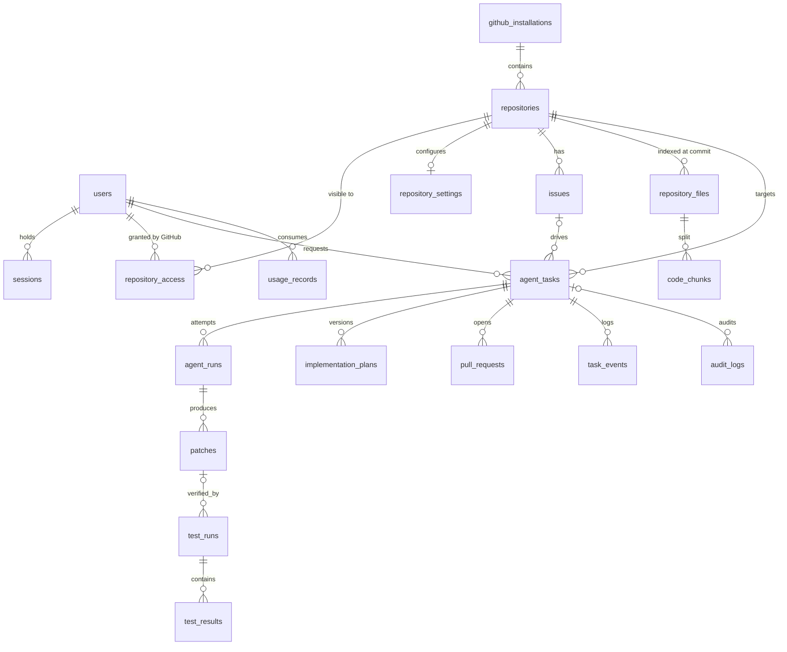

# Data model

Schema: `prisma/schema.prisma`. Initial migration: `prisma/migrations/20261027000000_init`.

## Integrity decisions

| Constraint | Why |
| --- | --- |
| `repositories.github_repo_id` unique | Repos are renamed and transferred; the numeric id is stable |
| `repository_access (user_id, repository_id)` primary key | One permission per user per repository, rebuilt from GitHub at sign-in ([ADR 0003](../decisions/0003-github-derived-access-and-opaque-sessions.md)) |
| `sessions.token_hash` unique | Lookup by hash; the raw token never touches the database |
| `issues (repository_id, github_issue_number)` unique | Webhook redelivery and re-import must upsert, not duplicate |
| `agent_runs (task_id, attempt_number)` unique | One row per bounded attempt; retries can't collide |
| `agent_tasks (repository_id, branch_name)` unique | Two tasks can never push to the same branch (NULLs allowed until a branch is assigned) |
| `implementation_plans (task_id, version)` unique | Revisions append; earlier plans are kept |
| `patches (task_id, diff_hash)` unique | Identical patch content is stored once per task |
| `pull_requests (repository_id, github_pr_number)` unique | One row per real PR |
| `idempotency_keys.key` primary key | Guards push/PR creation across retries and worker restarts |
| `webhook_deliveries.delivery_id` primary key | GitHub's `X-GitHub-Delivery` dedupes redelivered webhooks |

- `agent_tasks.base_sha` and `patches.base_sha` record exactly which commit was analyzed and patched.
- `test_results.output_summary` is bounded and sanitized; full logs go to object storage via `log_object_key`.
- No credential or token column exists anywhere. Session tokens are stored only as SHA-256 hashes; GitHub user tokens are never stored; installation tokens are minted on demand and held in memory only.
- Repositories leaving an installation are soft-removed (`removed_at`) and disabled, so task history is preserved.
- `repository_files` and `code_chunks` are **derived, versioned** data keyed by `commit_sha`, safe to drop and rebuild. Full-text (`tsvector`) and optional embedding columns arrive via raw SQL migration in week 3.
