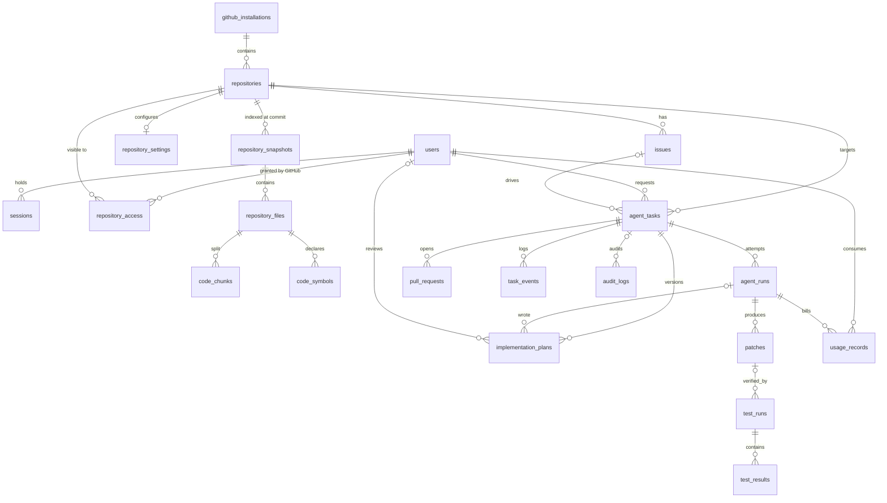

# Data model

Schema: `prisma/schema.prisma`. Migrations: `prisma/migrations/` (`init`, `auth_and_repository_access`, `repository_analysis`, `planning_and_runs`).

## Integrity decisions

| Constraint | Why |
| --- | --- |
| `repositories.github_repo_id` unique | Repos are renamed and transferred; the numeric id is stable |
| `repository_access (user_id, repository_id)` primary key | One permission per user per repository, rebuilt from GitHub at sign-in ([ADR 0003](../decisions/0003-github-derived-access-and-opaque-sessions.md)) |
| `sessions.token_hash` unique | Lookup by hash; the raw token never touches the database |
| `repository_snapshots (repository_id, commit_sha)` unique | A commit is indexed once; concurrent indexers collapse to one row |
| `repository_files (snapshot_id, path)` unique | One row per path per indexed commit |
| `issues (repository_id, github_issue_number)` unique | Webhook redelivery and re-import must upsert, not duplicate |
| `agent_runs (task_id, attempt_number)` unique | One row per bounded attempt; retries can't collide |
| `agent_tasks (repository_id, branch_name)` unique | Two tasks can never push to the same branch (NULLs allowed until a branch is assigned) |
| `implementation_plans (task_id, version)` unique | Revisions append; earlier plans are kept. Reviews are a compare-and-set on `status = PROPOSED`, so a plan is approved or sent back exactly once |
| `patches (task_id, diff_hash)` unique | Identical patch content is stored once per task |
| `pull_requests (repository_id, github_pr_number)` unique | One row per real PR |
| `idempotency_keys.key` primary key | Guards push/PR creation across retries and worker restarts |
| `webhook_deliveries.delivery_id` primary key | GitHub's `X-GitHub-Delivery` dedupes redelivered webhooks |

- `agent_tasks.base_sha` and `patches.base_sha` record exactly which commit was analyzed and patched.
- `test_results.output_summary` is bounded and sanitized; full logs go to object storage via `log_object_key`.
- No credential or token column exists anywhere. Session tokens are stored only as SHA-256 hashes; GitHub user tokens are never stored; installation tokens are minted on demand and held in memory only.
- Repositories leaving an installation are soft-removed (`removed_at`) and disabled, so task history is preserved.
- `repository_snapshots`, `repository_files`, `code_chunks`, and `code_symbols` are **derived, versioned** data keyed by commit, safe to drop and rebuild. A snapshot and all its rows are written in one transaction; only the newest `SNAPSHOTS_TO_KEEP` per repository are kept.
- `code_chunks.search_vector` is a generated column, `to_tsvector('simple', search_text)`, with a GIN index. `search_text` holds normalized identifier terms (`getUserById` → `getuserbyid get user by id`), so code identifiers and plain-language task descriptions meet. Embeddings remain an optional later addition.
- `agent_tasks.analysis` stores the `ContextPackage` (pinned SHA, project profile, ranked snippets with line ranges) handed to planning. It is validated against the shared schema on write and again on read.
- `agent_runs` has one row per model call: the `stage` that made it, the requested `model`, `token_usage` (input, output, cache write, cache read), and the `error` if it failed. Attempt numbers count across stages and queue retries.
- `usage_records` has one row per **billed** call, linked to its run, priced at the model that actually answered (server-side fallback can change it) using `MODEL_PRICING` in `agent-core`. `input_tokens` includes cached input. The task token budget is checked against these rows.
- `implementation_plans.plan_json` is validated against `ImplementationPlanSchema` before insert and again on read; a plan that no longer validates is withheld from the API. `status` is `PROPOSED`, `APPROVED`, or `CHANGES_REQUESTED`, with `feedback`, `reviewed_by`, and `reviewed_at` recording the human review.
