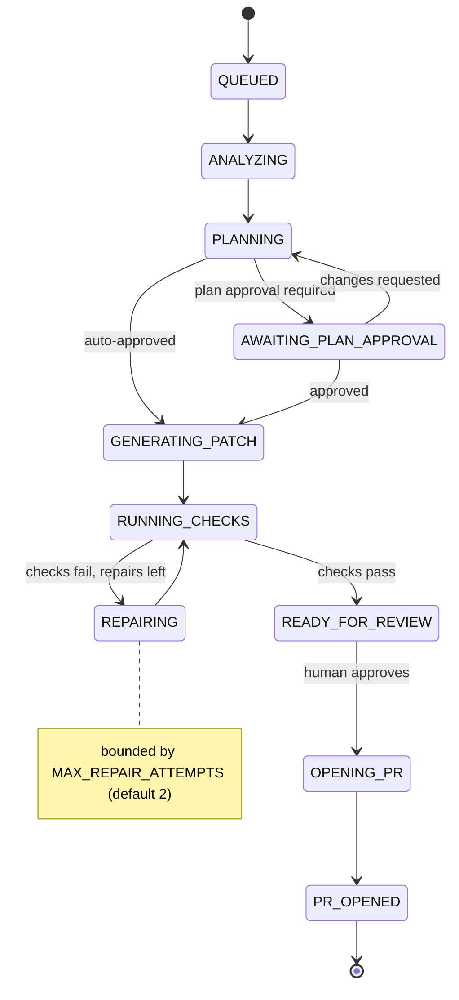

# Agent task state machine

Source of truth: `packages/contracts/src/task-status.ts`. The Prisma enum mirrors it; transitions are enforced in code and covered by tests.

Every non-terminal state may also move to `FAILED` or `CANCELLED`. Terminal states: `PR_OPENED`, `FAILED`, `CANCELLED`.

## Rules

1. **No skipping verification.** `GENERATING_PATCH` can only reach `READY_FOR_REVIEW` through `RUNNING_CHECKS`.
2. **Bounded repair.** `decideAfterChecks` in `agent-core` fails the task once the repair budget is spent, or immediately on a safety violation (timeout, resource limit, policy breach), even if checks passed.
3. **Resume, don't restart.** The worker always starts from the persisted status, so redelivery of a job after a crash continues from where it stopped.
4. **Humans gate side effects.** The agent never merges, and never opens a PR without a `READY_FOR_REVIEW → OPENING_PR` approval.
5. **Plans are reviewed by version.** Approving or requesting changes names the plan version the reviewer saw. Both are compare-and-sets on the task status and the plan status, so a stale or second review gets `409`. A task gets at most `MAX_PLAN_VERSIONS` (3) plans.
6. **Failures are classified.** Transient failures (rate limits, provider outages, dropped connections) leave the status unchanged and are retried by the queue with backoff. Everything else, including a stage timeout, a declined task, or an exhausted token budget, moves the task to `FAILED` with a reason.
7. **Cancellation wins.** `CANCELLED` is set by the API. A running job notices, aborts its in-flight work, and exits without writing a status.
